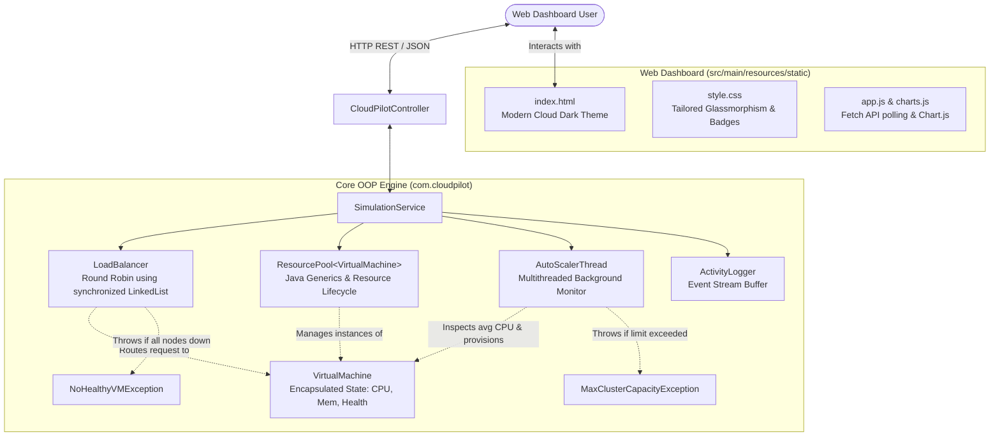

# CloudPilot: Cloud Virtual Machine Pool Load Balancer & Auto-Scaler

> **B.Tech 3rd Semester Academic Project**  
> **Course**: Object-Oriented Programming (Java)  
> **Platform**: Spring Boot, Java 17+, Maven, HTML5, CSS3, JavaScript, Chart.js

---

## 🌟 Executive Summary

**CloudPilot** is an enterprise-grade cloud infrastructure simulation platform that models how modern cloud providers (such as AWS Elastic Load Balancing and Auto Scaling Groups) dynamically manage virtual machine pools.

The system continuously balances incoming client requests across available virtual machines using a **synchronized Round Robin algorithm**, detects node failures, and leverages an autonomous background **multithreaded AutoScaler** to dynamically spin up new VM instances whenever cluster-wide average CPU utilization crosses **80%**.

---

## 📐 System Architecture



---

## ☕ Core OOP & Academic Requirements Mapping

| Concept | Java Class | Implementation Details |
|---|---|---|
| **Encapsulation** | [`VirtualMachine.java`](file:///src/main/java/com/cloudpilot/model/VirtualMachine.java) | Private fields (`cpuUtilizationPercentage`, `activeConnections`, `memoryUsedMB`, `isHealthy`), controlled mutating methods (`assignRequest()`, `coolDown()`, `markHealthy()`). |
| **Java Generics (`<T>`)** | [`ResourcePool.java`](file:///src/main/java/com/cloudpilot/pool/ResourcePool.java) | Fully generic resource container `ResourcePool<T>` managing resource states (available vs. active) with type safety. |
| **Data Structures & Collections** | [`LoadBalancer.java`](file:///src/main/java/com/cloudpilot/balancer/LoadBalancer.java) | `LinkedList<VirtualMachine>` wrapped in synchronized methods to achieve thread-safe circular Round Robin scheduling. |
| **Multithreading & Concurrency** | [`AutoScalerThread.java`](file:///src/main/java/com/cloudpilot/autoscaler/AutoScalerThread.java) | Background daemon thread extending `java.lang.Thread` executing periodic telemetry checks (every 2.5s) and safe scale-out. |
| **Custom Exception Handling** | [`exceptions/`](file:///src/main/java/com/cloudpilot/exceptions) | Custom unchecked exceptions: `MaxClusterCapacityException` and `NoHealthyVMException`, caught globally by `GlobalExceptionHandler`. |
| **REST API & Web MVC** | [`CloudPilotController.java`](file:///src/main/java/com/cloudpilot/controller/CloudPilotController.java) | Spring Boot REST controller exposing endpoints for frontend dashboard synchronization. |

---

## 🔌 REST API Endpoints

| Method | Endpoint | Description |
|---|---|---|
| `GET` | `/api/dashboard` | Returns consolidated cluster metrics (total VMs, healthy, unhealthy, avg CPU, active conns, total requests). |
| `GET` | `/api/vms` | Returns array of all registered virtual machines with telemetry. |
| `POST` | `/api/requests` | Dispatches a single client request using Round Robin load balancing. |
| `POST` | `/api/requests/batch?count=10` | Dispatches a batch of requests sequentially in circular order. |
| `POST` | `/api/simulation/surge` | Injects sudden high load pushing average CPU above 80% to demonstrate auto-scaling. |
| `POST` | `/api/vms/{vmId}/unhealthy` | Marks a specified VM as UNHEALTHY (skipped by Load Balancer). |
| `POST` | `/api/vms/{vmId}/heal` | Restores an unhealthy VM back into the active rotation. |
| `POST` | `/api/simulation/reset` | Resets cluster state back to the 3 baseline healthy VMs. |
| `POST` | `/api/monitoring/pause` | Pauses the AutoScaler background monitoring thread. |
| `POST` | `/api/monitoring/resume` | Resumes the AutoScaler background monitoring thread. |
| `GET` | `/api/logs` | Fetches recent real-time activity and scaling event logs. |

---

## 🚀 How to Run in IntelliJ IDEA

### Step 1: Open the Project in IntelliJ IDEA
1. Launch **IntelliJ IDEA**.
2. Select **File → Open...**
3. Browse to and select the `CloudPilot` folder (`c:\Users\mohanlalsolanki\OneDrive\Desktop\CloudPilot`).
4. Click **OK** (Open as Project).

### Step 2: Allow Maven to Sync
1. IntelliJ will automatically detect `pom.xml`.
2. Wait a few moments while IntelliJ indexes dependencies and configures the Project SDK (Java 17 or higher).

### Step 3: Run the Application
1. Navigate to: `src/main/java/com/cloudpilot/CloudPilotApplication.java`.
2. Click the **Green Run Triangle** ▶️ next to the `main(String[] args)` method (or press `Shift + F10`).
3. You will see the Spring Boot banner and startup logs in the Run console:
   ```text
   =================================================
     CloudPilot - Cloud VM Load Balancer & Auto-Scaler
     Server running at: http://localhost:8080
   =================================================
   ```

### Step 4: Open the Dashboard
1. Open your web browser (Chrome, Edge, Firefox).
2. Go to: **[http://localhost:8080](http://localhost:8080)**.
3. The dashboard will load with the 3 initial virtual machines (`VM-01`, `VM-02`, `VM-03`) and live Chart.js graphs.

---

## 🧪 Simulation Demonstration Guide (Viva / Presentation)

### Demo 1: Round Robin Scheduling
- Click **"Send 1 Request"** multiple times.
- Watch the **Round Robin Request Distribution** chart.
- Notice how requests increment sequentially across `VM-01`, then `VM-02`, then `VM-03`, then wrap back to `VM-01`.

### Demo 2: Fault Tolerance & Failover
- In the command bar or on `VM-02`'s card, click **"Mark Unhealthy"**.
- `VM-02` turns red (`UNHEALTHY`).
- Click **"Send 10 Requests"**.
- Check the activity log: the Load Balancer automatically skips `VM-02` and routes only to healthy VMs (`VM-01` and `VM-03`).
- If you mark all 3 VMs unhealthy, the backend throws `NoHealthyVMException` and a clear error notification appears on the dashboard.

### Demo 3: Dynamic Auto-Scaling (>80% CPU)
- Click **"Simulate Traffic Surge"**.
- Average CPU load spikes above **80%** (visualized on the red threshold line in Chart.js).
- Within 2.5 seconds, `AutoScalerThread` detects high load, initiates scale-out, provisions `VM-04`, and adds it to the pool.
- A purple activity log appears: `Auto-scaling triggered: VM-04 provisioned and attached to pool & load balancer`.
- `VM-04` appears dynamically on the dashboard with the `[AUTOSCALED]` badge!

### Demo 4: Maximum Cluster Capacity Ceiling
- Trigger traffic surges repeatedly until the cluster reaches maximum capacity (8 VMs).
- The system prevents infinite provisioning and gracefully throws and logs `MaxClusterCapacityException`.

### Demo 5: Clean Reset
- Click **"Reset Simulation"**.
- The cluster seamlessly reverts back to its 3 clean baseline VMs (`VM-01`, `VM-02`, `VM-03`).

---

## 💡 Viva Questions & Conceptual Answers

<details>
<summary><strong>Q1: What is the purpose of the generic <code>ResourcePool&lt;T&gt;</code>?</strong></summary>

> **Answer**: `ResourcePool<T>` demonstrates Java Generics (`<T>`). It provides a reusable, type-safe pool mechanism to manage resource lifecycle (available vs. active), preventing resource starvation. In CloudPilot, it is instantiated as `ResourcePool<VirtualMachine>`, but the same class could manage database connections or thread workers without code changes.
</details>

<details>
<summary><strong>Q2: Why is <code>LinkedList&lt;VirtualMachine&gt;</code> synchronized in <code>LoadBalancer</code>?</strong></summary>

> **Answer**: In a multi-user web application, multiple HTTP client requests can arrive simultaneously. Using `synchronized` ensures thread safety, preventing race conditions where multiple threads might mutate the `currentIndex` or list pointer simultaneously.
</details>

<details>
<summary><strong>Q3: How does <code>AutoScalerThread</code> operate in the background?</strong></summary>

> **Answer**: `AutoScalerThread` extends `java.lang.Thread` and is marked as a daemon thread (`setDaemon(true)`). It runs an infinite loop with `Thread.sleep(2500)`, inspecting average CPU across healthy VMs. If load exceeds 80%, it synchronizes on shared resources to safely instantiate and register a new `VirtualMachine`.
</details>

<details>
<summary><strong>Q4: How does CPU decay work?</strong></summary>

> **Answer**: Real cloud workloads are transient. Once requests finish, VMs shouldn't stay at 90% CPU forever. During each monitor cycle, `AutoScalerThread` decreases active connection counts and cools down CPU load by ~3% per tick back toward the 40% baseline.
</details>

---

## 👥 Team Collaboration (GitHub Guide)

```bash
# Initialize git repository
git init

# Add all files
git add .

# Initial commit
git commit -m "feat: complete CloudPilot virtual machine load balancer and auto-scaler"

# Link to GitHub
git remote add origin https://github.com/<your-username>/CloudPilot.git
git branch -M main
git push -u origin main
```
